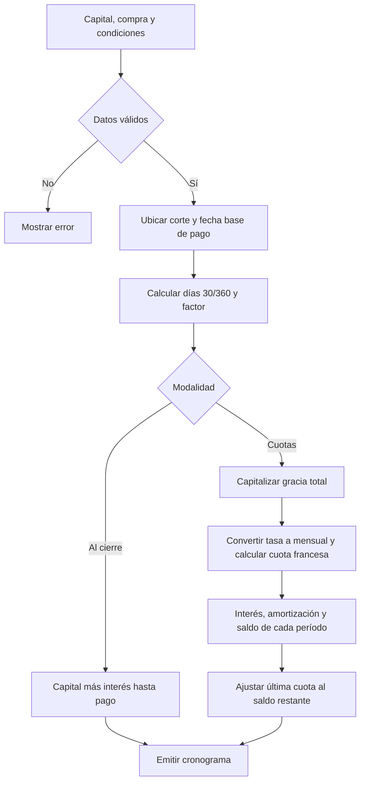
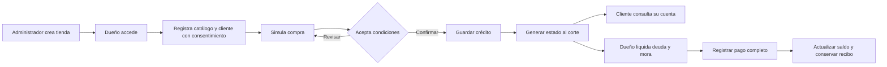

# Algoritmos y flujo del negocio

El pseudocódigo siguiente describe el cálculo; los diagramas posteriores describen las actividades. Implementación: `finance/FinancialEngine.java` y los servicios de `credit`, `payment` y `statement`.

## Factor de acumulación

```text
FACTOR(tasa_porcentaje, tipo, base, días, frecuencia)
    validar tasa finita entre 0 y 1000; días entero no negativo
    validar base en {30, 360}; frecuencia en {1, 2, 4, 6, 12, 24, 360}
    r ← tasa_porcentaje / 100
    si tipo = efectiva: retornar (1 + r)^(días / base)
    si base = 30: retornar (1 + r)^(días / 30)
    retornar (1 + r / frecuencia)^(frecuencia × días / 360)
```

## Plan de pagos

```text
PLAN(capital, fecha_compra, condiciones, modalidad, meses)
    validar capital > 0 y plazo permitido
    corte ← día pactado del mes de compra, limitado al último día real, con hora pactada
    si fecha_compra > corte: corte ← corte del mes siguiente
    fecha_base ← día de pago del mes de corte
    si día_pago < día_corte: fecha_base ← día de pago del mes siguiente
    ajustar fecha_base al último día real de su mes si es necesario
    d ← DÍAS_30_360(fecha_compra, fecha_base)
    acumulado ← REDONDEAR(capital × FACTOR(tasa, tipo, base, d, frecuencia), 2)
    si modalidad = al_cierre:
        retornar una obligación con capital, interés = acumulado − capital,
                importe = acumulado y vencimiento = fecha_base
    financiado ← acumulado
    gracia ← financiado − capital
    i ← FACTOR(tasa, tipo, base, 30, frecuencia) − 1
    si i = 0: cuota ← REDONDEAR(financiado / meses, 2)
    si i ≠ 0: cuota ← REDONDEAR(financiado × i / (1 − (1 + i)^(-meses)), 2)
    saldo ← financiado
    para k desde 1 hasta meses:
        interés ← REDONDEAR(saldo × i, 2)
        amortización ← saldo si k = meses; en otro caso REDONDEAR(cuota − interés, 2)
        rechazar amortización negativa, mayor que saldo o cierre prematuro por redondeo
        vencimiento ← mes(fecha_base) + k, usando siempre el día de pago pactado
        emitir k, vencimiento, amortización, interés, amortización + interés
        saldo ← REDONDEAR(saldo − amortización, 2)
    comprobar saldo = 0
```

`DÍAS_30_360` es `360×(año2−año1) + 30×(mes2−mes1) + min(día2,30) − min(día1,30)`. El orden de fechas se valida antes del cálculo. El redondeo monetario es HALF_UP, no truncamiento.

## Registrar la venta sin exceder el crédito

```text
REGISTRAR_VENTA(usuario, tienda, solicitud)
    verificar sesión, CSRF, perfil y tienda activa
    comenzar transacción de escritura
    buscar cliente y productos dentro de la tienda autorizada
    validar actividad, moneda, precios del catálogo, cantidades y permiso de cuotas
    recalcular plan y comprobar que el ciclo no está cerrado
    capital_pendiente ← sumar amortizaciones de obligaciones aún no pagadas
    si capital_pendiente + nuevo_capital_financiado > límite: revertir y rechazar
    guardar compra, copia de las condiciones, líneas de productos y cronograma
    registrar usuario, acción y fecha en auditoría
    confirmar transacción
```

La simulación usa las mismas reglas, pero no inserta registros ni reserva crédito. Confirmar recalcula todo: dos solicitudes simultáneas no pueden gastar el mismo disponible.

## Liquidar y cobrar

```text
LIQUIDAR(cliente, hoy)
    obtener cuotas impagas con vencimiento ≤ hoy
    si no hay exigibles: elegir todas las cuotas del siguiente vencimiento
    para cada cuota:
        días_mora ← 0 si hoy ≤ vencimiento; en otro caso DÍAS_30_360(vencimiento, hoy)
        factor_mora ← FACTOR usando la tasa moratoria guardada en la compra
        mora ← REDONDEAR(importe_cuota × (factor_mora − 1), 2)
        emitir base, fecha, días, tasa y mora
    retornar suma de importes + suma de moras

COBRAR(solicitud)
    comenzar transacción de escritura
    recalcular liquidación para la fecha del servidor
    si importe_recibido ≠ total o no existen cuotas: revertir y rechazar
    guardar recibo y líneas con la mora; vincular cada cuota al recibo
    registrar auditoría; confirmar transacción
```

## Generar cierres

```text
CERRAR_CUENTAS(ahora)
    para cada cliente con compras:
        recorrer sus cortes desde el primer ciclo hasta ahora
        ajustar cada corte a su mes usando el día pactado, no el día ajustado anterior
        si llegó su fecha/hora y no existe cierre para cliente+ciclo:
            construir estado con compras ordenadas, cuotas e intereses correspondientes
            guardar snapshot JSON y fecha de generación
    confirmar; repetir cada minuto mientras el servidor esté encendido
```

El cierre no se sobrescribe. La consulta actual calcula mora hasta la fecha consultada; abrir un cierre muestra su fotografía original. La recuperación usa el calendario vigente del cliente. Las condiciones de cada compra siguen guardadas en esa venta.

## Diagrama del cálculo



## Actividad del comercio



Fuente del método de amortización: [OpenStax, Principles of Finance 2e, 8.3](https://openstax.org/books/principles-finance-2e/pages/8-3-loan-amortization). La gracia, el corte y la prohibición de pagos parciales corresponden al enunciado SI642; la convención exacta de días y redondeo está documentada en [FINANZAS.md](FINANZAS.md).
