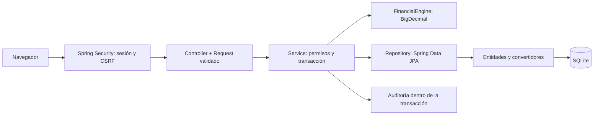

# Arquitectura de Cuenta Clara

Cuenta Clara es una aplicación web con backend Java 21 y Spring Boot 3.5. El navegador y la API se sirven desde el mismo origen. El frontend usa HTML, CSS y JavaScript; funciona en computadora y celular, sin Flutter ni instalación obligatoria.

## Recorrido de una operación

Una venta entra por `CreditController`. `SaleRequest` valida su formato. `CreditService` identifica la tienda desde la sesión, busca el cliente y los productos, calcula el importe con precios guardados y consulta `FinancialEngine`. Después comprueba el crédito disponible y, si corresponde, que la simulación aceptada siga vigente. La venta, los productos vendidos, las cuotas y la auditoría se guardan dentro de **una misma transacción**. Un error revierte todo.

## Cómo encontrar cada parte

Los paquetes se agrupan por función. Cada módulo contiene su entidad, repositorio, servicio, controlador y DTOs cuando los necesita. Es la [organización por dominio sugerida por Spring Boot](https://docs.spring.io/spring-boot/reference/using/structuring-your-code.html).

| Módulo | Entidades principales | Responsabilidad |
| --- | --- | --- |
| `auth` | UserAccount, SessionToken, LoginChallenge, LoginAttempt | Acceso, contraseñas y sesiones |
| `store` | Store | Tiendas y alcance de permisos |
| `customer` | Customer | Datos personales y acuerdo de crédito |
| `catalog` | Product | Catálogo de productos y servicios |
| `credit` | CreditSale, SaleItem, Installment | Compras y cronogramas |
| `payment` | Payment, PaymentLine | Liquidación completa y mora cobrada |
| `statement` | ClosedStatement | Consultas y fotografías del cierre |
| `audit` | AuditEvent | Usuario, acción y fecha de cada movimiento |
| `finance` | Sin persistencia | Tasas, calendario comercial, gracia y cuotas |
| `dashboard` | Sin entidades propias | Datos del resumen según perfil |
| `config` / `shared` | Sin entidades propias | Configuración, reloj, errores y convertidores |

Ejemplo concreto en `src/main/java/pe/cuentaclara/customer/`:

- `Customer.java`: entidad JPA que representa la tabla `customers`.
- `CustomerRepository.java`: acceso mediante Spring Data JPA.
- `CustomerRequest.java`: campos y validaciones de entrada.
- `CustomerResponse.java`: datos que puede recibir la interfaz.
- `CustomerService.java`: consentimiento, condiciones, usuario y auditoría.
- `CustomerController.java`: rutas y autorización del perfil.

Las dependencias se reciben por constructor y se guardan en campos `final`. No se utiliza Lombok. Las relaciones JPA son diferidas y `open-in-view=false`: los servicios construyen DTOs dentro de sus transacciones. No se serializan entidades ni contraseñas.

## Dinero, fechas y persistencia

`FinancialEngine` usa `BigDecimal`, precisión de 36 dígitos para factores y `HALF_UP` a dos decimales para importes. `big-math` calcula potencias decimales. Ningún cálculo definitivo pasa por `double`. Las fórmulas están en [FINANZAS.md](FINANZAS.md).

Los convertidores de `shared` guardan importes decimales como texto e instantes locales en ISO. Esto conserva las 14 tablas y los valores de la versión anterior. `ddl-auto=none` evita que Hibernate cambie el esquema automáticamente. El DDL idempotente vive en `src/main/resources/db/schema.sql`.

SQLite tiene un escritor. El pool contiene **una conexión** para serializar transacciones completas de esta instancia: una compra no puede comprobar un saldo anterior mientras otra lo consume. Las peticiones HTTP pueden llegar juntas y esperan su turno. Esta configuración es adecuada para la entrega y comercios pequeños; no es una arquitectura para varias réplicas. Para otra escala, cambiar a PostgreSQL implica una migración del esquema, estrategia de bloqueo y nuevas pruebas, no solo cambiar una URL.

Las ventas conservan precios y condiciones pactadas. Los cierres se ejecutan al arrancar y cada minuto mediante `StatementClosingJob`; se recuperan los períodos pendientes si el servidor estuvo apagado. Un cierre ya guardado no se reemplaza. El reloj usa `America/Lima` y se sustituye por un reloj fijo en pruebas. Los días 30/31 se ajustan al último día de un mes corto y se recuperan después.

## Acceso y seguridad

`SecurityConfig` establece rutas públicas, cabeceras, cookies y CSRF. `SessionAuthenticationFilter` identifica al usuario por `cc_session`; `SessionService` vuelve a comprobar que el usuario y su tienda sigan activos. `@PreAuthorize` controla los perfiles y `StoreAccessService` limita cada operación a su negocio o a la cuenta del cliente.

- Contraseñas nuevas con PBKDF2-HMAC-SHA256, sal individual y 600 000 iteraciones. Las claves anteriores se verifican y se actualiza su derivación al iniciar sesión correctamente.
- Sesiones persistidas de ocho horas, cookie HttpOnly y SameSite=Lax; `SECURE_COOKIES=true` al servir mediante HTTPS.
- Token CSRF en operaciones autenticadas. El login usa un desafío aritmético de cinco minutos y un solo uso; bloqueo temporal por usuario e IP ante fallos repetidos.
- Cierre de sesión y revocación de otras sesiones al cambiar la contraseña.
- Consultas parametrizadas, validación de DTOs, errores centralizados en `ApiExceptionHandler` y comprobación de precios/moneda en el servidor.
- Las bajas son lógicas: conservan operaciones e historial. El consentimiento incluye fecha y versión.

La protección CSRF usa [Spring Security](https://docs.spring.io/spring-security/reference/servlet/exploits/csrf.html); las transacciones siguen el [modelo declarativo de Spring](https://spring.io/guides/gs/managing-transactions/). El desafío aritmético no se presenta como MFA ni como verificación de correo.

## Frontend y desarrollo

`src/main/resources/static/app.js` gestiona las vistas y los formularios; `styles.css` define escritorio, celular e impresión. Iconos, SVG y fuentes se sirven localmente. Los importes mostrados con JavaScript son informativos: el backend recalcula al confirmar.

Para un cambio de regla, empieza por el servicio y su prueba. Para un campo, revisa entidad, DTO, esquema y formulario. Usa `./mvnw verify` o `.\mvnw.cmd verify` antes de integrar. Los casos financieros están en `src/test/`; el recorrido de Chromium en `tests/browser_smoke.py`.

## Ejecución y respaldo

El README incluye el arranque con Maven Wrapper y Docker. `.env.example` enumera variables; `.env` no se carga automáticamente. Una base existente nunca se reinicia al activar la demostración.

Ejecuta una sola instancia por archivo SQLite. Conserva `DB_PATH` en disco persistente. Para un respaldo en caliente, usa la API de backup de SQLite o el comando `.backup` de su herramienta; una copia directa del archivo mientras hay escrituras no equivale a un respaldo consistente. Detén el proceso antes de restaurar. La [guía de migración](MIGRACION_JAVA.md) explica el cambio desde la versión anterior.

Para publicar se requiere proxy HTTPS, cookies seguras y una política operativa de copias y accesos. La base, las claves y los datos personales quedan fuera de Git.
