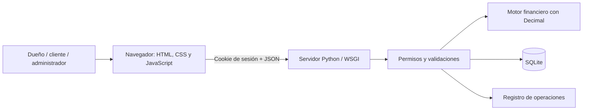
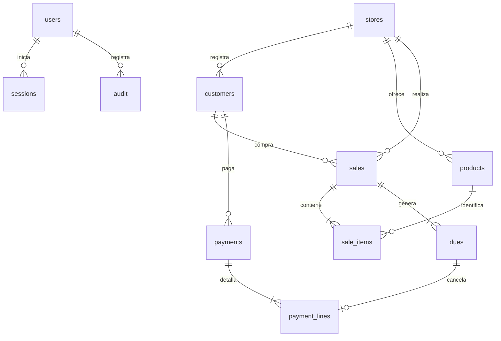

# Cómo está organizada Cuenta Clara

La aplicación reemplaza el cuaderno de fiados del negocio. La información vive en una base SQLite y el navegador se comunica con el servidor mediante una API JSON del mismo origen.

## Componentes



| Archivo | Para qué sirve |
| --- | --- |
| `app.py` | API, sesiones, validaciones, acceso a datos y arranque del servidor. |
| `finance.py` | Conversión de tasas, gracia, cuotas y mora. |
| `schema.sql` | Tablas, relaciones e índices de la base de datos. |
| `static/index.html` | Estructura de la interfaz. |
| `static/app.js` | Navegación, formularios y consultas al servidor. |
| `static/styles.css` | Apariencia, adaptación a celulares e impresión. |
| `static/fonts/` | Public Sans y su licencia SIL Open Font License. Se sirve desde la propia aplicación. |
| `tests/` | Pruebas del motor financiero y de las operaciones del servidor. |

No se necesita un proceso de compilación para el frontend. La lógica de negocio y los cálculos definitivos se ejecutan en el servidor.

## Usuarios y separación de tiendas

- **Administrador de plataforma:** registra y desactiva tiendas; administra el acceso a la plataforma.
- **Administrador del negocio:** administra sus clientes, catálogo, ventas y pagos.
- **Cliente:** consulta exclusivamente su propia cuenta.

El identificador de tienda de la sesión delimita las consultas. Cambiar un ID en una petición no concede acceso a otra tienda. Los clientes tampoco pueden registrar ventas o pagos.

Las bajas son lógicas: desactivar un registro impide nuevas operaciones sin borrar su historia. Las ventas guardan una copia de las condiciones financieras y de los precios utilizados.

## Datos principales



Los importes se almacenan como texto decimal para conservar exactamente los centavos. Los cálculos usan `Decimal`; los montos mostrados por el navegador no sustituyen las validaciones del servidor.

## Seguridad aplicada

- Contraseñas derivadas con sal individual; no se guardan contraseñas en texto.
- Sesiones con vencimiento y cookies HttpOnly.
- Token CSRF obligatorio para las operaciones autenticadas que cambian información.
- Desafío de verificación en el acceso y control de intentos fallidos.
- Consultas SQL parametrizadas y comprobaciones de permisos en el servidor.
- Registro de operaciones para identificar usuario, acción y fecha.
- Consentimiento de tratamiento de datos versionado y registrado al crear el cliente.

Antes de usar datos reales, el negocio debe definir sus propios plazos de conservación, procedimientos de atención de solicitudes y política de privacidad. El texto informativo incluido es una base funcional para el proyecto académico.

## Fechas y dinero

Las fechas de corte y pago admiten días del 1 al 28 para tener vencimientos existentes en todos los meses. La base financiera es comercial de 30 días por mes. Cada crédito conserva su moneda: no se convierten soles a dólares ni se mezclan sus totales. El documento [FINANZAS.md](FINANZAS.md) explica las fórmulas y supuestos.

## Desarrollo y cambios

1. Crear una rama para el cambio.
2. Probar el flujo afectado y ejecutar `python -m unittest discover -s tests -v`.
3. Revisar el diff antes de subirlo.
4. Integrar a `main` cuando los controles automáticos estén correctos.

Cada integrante debe usar su propia cuenta y un correo vinculado a GitHub para que los commits se atribuyan correctamente.

## Ejecución y respaldo

El servidor usa la biblioteca estándar de Python 3.12 y el paquete tzdata para garantizar las zonas horarias en Windows y contenedores. Instala requirements.txt antes de arrancar. El arranque, la demostración y las variables de configuración están en el README.

Para Docker:

```sh
docker build -t cuenta-clara .
docker run --rm -p 8000:8000 --env-file .env -e HOST=0.0.0.0 -e DB_PATH=/data/cuenta.db -v cuenta-clara-data:/data cuenta-clara
```

Crear primero `.env` a partir de `.env.example` y definir una contraseña de administrador segura. El volumen mantiene la base aunque se elimine el contenedor. Para un respaldo consistente con el servidor activo, usar la API de respaldo de SQLite; también se puede detener el servidor y copiar la base.

Para exponerla en Internet se necesita HTTPS mediante un proxy, configurar `SECURE_COOKIES=1`, limitar peticiones y establecer respaldos. El servidor incluido permite ejecutar y presentar el proyecto; un despliegue de producción debe dimensionarse y revisarse para su entorno.
