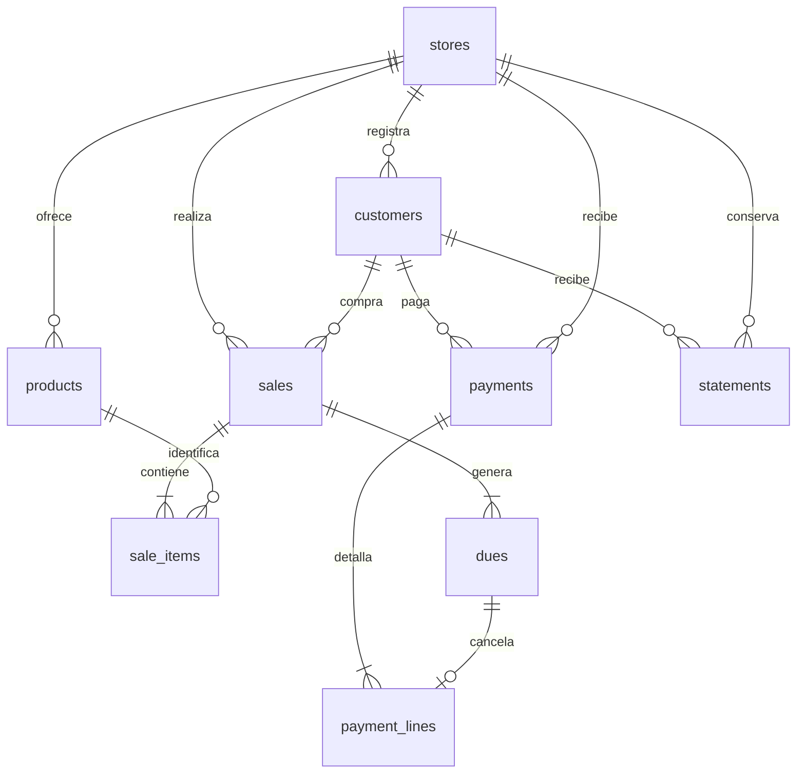
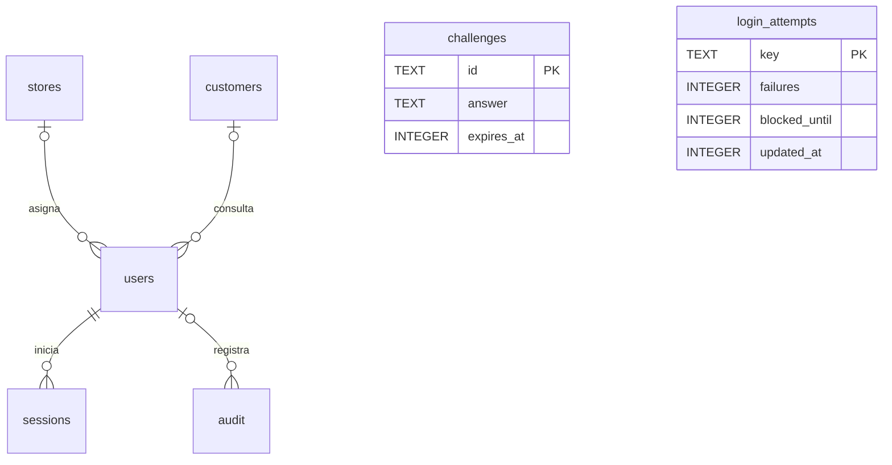

# Modelo de datos y diccionario físico

El modelo usa 14 tablas SQL. El DDL ejecutable es [schema.sql](../schema.sql). Los diagramas expresan relaciones de negocio; la tabla de cada entidad especifica las claves realmente declaradas.

## Modelo lógico del crédito

## Acceso y trazabilidad

## Convenciones físicas

SQLite usa afinidad de tipos: TEXT no impone un tamaño fijo. Los límites de entrada de [ANALISIS.md](ANALISIS.md) los valida el servidor. Las fechas son texto ISO, los importes texto decimal y los booleanos INTEGER 0/1. Los campos calculados no tienen una longitud textual máxima adicional: dependen del importe y plazo validados. No se usa REAL para dinero.

Las claves foráneas se activan en cada conexión. Las transacciones serializan escrituras y mantienen venta/cuotas y recibo/líneas como unidades. La base usa WAL. Las bajas lógicas conservan referencias; no se elimina físicamente historia desde la interfaz.

## Restricciones e índices

Usuario único sin distinguir mayúsculas; documento único dentro de tienda; cierre único por cliente+ciclo. CHECK restringe roles y las monedas declaradas en clientes/productos. Índices de clientes por tienda, productos por tienda, ventas por cliente/tienda y cuotas por vencimiento/pago.

La relación una cuota–una línea de pago y un usuario de cliente se controlan mediante el flujo transaccional de la API; el DDL no contiene UNIQUE para todas esas relaciones conceptuales. No se atribuyen al esquema restricciones que solo aplica el servidor. El historial de precios y condiciones se duplica deliberadamente para preservar el acuerdo original.

## Diccionario

“—” en valor por defecto significa que el DDL no declara uno; la API puede generar el valor. “PK” identifica clave primaria; se muestran las referencias SQL donde existen.

### users

| Columna | Tipo SQL | Nulo / clave | Inicial DDL | Descripción y validación |
| --- | --- | --- | --- | --- |
| id | INTEGER | PK | — | Identificador de la fila; INTEGER PRIMARY KEY asignado por SQLite. |
| username | TEXT | No nulo | — | Acceso único COLLATE NOCASE; 3–80 letras, números, punto, @, guion o guion bajo. |
| name | TEXT | No nulo | — | Nombre legible; máximo 120 caracteres en entradas de negocio. |
| password | TEXT | No nulo | — | Sal hexadecimal de 32 caracteres, dos puntos y hash PBKDF2-SHA256 de 64; 97 caracteres. No es texto de la clave. |
| role | TEXT | No nulo | — | platform, merchant o customer; restricción CHECK. |
| store_id | INTEGER | Admite NULL; FK stores.id | — | NULL para administrador global; tienda asignada para comercio/cliente. |
| customer_id | INTEGER | Admite NULL; FK customers.id | — | NULL salvo perfil cliente; identificación de su cuenta de consulta. |
| active | INTEGER | No nulo | 1 | Baja lógica: 1 activo, 0 desactivado; inicial 1. |

### stores

| Columna | Tipo SQL | Nulo / clave | Inicial DDL | Descripción y validación |
| --- | --- | --- | --- | --- |
| id | INTEGER | PK | — | Identificador de la fila; INTEGER PRIMARY KEY asignado por SQLite. |
| name | TEXT | No nulo | — | Nombre legible; máximo 120 caracteres en entradas de negocio. |
| business | TEXT | No nulo | — | Rubro libre, máximo 100 caracteres. |
| address | TEXT | No nulo | '' | Dirección del comercio, opcional, máximo 240; inicial cadena vacía. |
| active | INTEGER | No nulo | 1 | Baja lógica: 1 activo, 0 desactivado; inicial 1. |

### customers

| Columna | Tipo SQL | Nulo / clave | Inicial DDL | Descripción y validación |
| --- | --- | --- | --- | --- |
| id | INTEGER | PK | — | Identificador de la fila; INTEGER PRIMARY KEY asignado por SQLite. |
| store_id | INTEGER | No nulo; FK stores.id | — | Tienda propietaria. La API verifica el alcance de la sesión. |
| name | TEXT | No nulo | — | Nombre legible; máximo 120 caracteres en entradas de negocio. |
| document | TEXT | No nulo | — | Identificación, 1–30 caracteres; combinación tienda+documento única. |
| email | TEXT | No nulo | — | Correo de contacto, máximo 160; formato validado por API. |
| phone | TEXT | No nulo | '' | Teléfono opcional, máximo 30; cadena vacía por defecto. |
| currency | TEXT | No nulo | — | PEN o USD, sin conversión entre monedas. |
| credit_limit | TEXT | No nulo | — | Límite de capital, decimal de hasta 2 posiciones; entrada 0.01–10000000. |
| rate | TEXT | No nulo | — | Tasa compensatoria porcentual, decimal hasta 6 posiciones; 0–1000 como límite técnico. |
| rate_kind | TEXT | No nulo | — | effective o nominal, validación API. |
| rate_period | INTEGER | No nulo | — | Base de la tasa compensatoria: 30 o 360 días. |
| frequency | INTEGER | No nulo | — | Capitalizaciones al año: 1, 2, 4, 6, 12, 24 o 360; API inicial 12. |
| late_rate | TEXT | No nulo | — | Tasa moratoria porcentual, decimal hasta 6 posiciones; 0–1000 como límite técnico. |
| late_kind | TEXT | No nulo | — | effective o nominal para la mora. |
| late_period | INTEGER | No nulo | — | Base moratoria: 30 o 360 días. |
| late_frequency | INTEGER | No nulo | — | Frecuencia anual de capitalización moratoria; mismo catálogo que frequency. |
| max_months | INTEGER | No nulo | — | Plazo máximo permitido: entero 1–60. |
| cutoff_day | INTEGER | No nulo | — | Día pactado 1–31; se ajusta por mes sin cambiar este valor. |
| cutoff_hour | INTEGER | No nulo | — | Hora entera de corte 0–23; API inicial 23. |
| pay_day | INTEGER | No nulo | — | Día pactado de vencimiento 1–31; ajuste a meses cortos. |
| consent_at | TEXT | No nulo | — | Fecha-hora de aceptación registrada por servidor, ISO de 19 caracteres. |
| consent_version | TEXT | No nulo | '1' | Versión del texto de privacidad aceptado; actual 1. |
| active | INTEGER | No nulo | 1 | Baja lógica: 1 activo, 0 desactivado; inicial 1. |

### products

| Columna | Tipo SQL | Nulo / clave | Inicial DDL | Descripción y validación |
| --- | --- | --- | --- | --- |
| id | INTEGER | PK | — | Identificador de la fila; INTEGER PRIMARY KEY asignado por SQLite. |
| store_id | INTEGER | No nulo; FK stores.id | — | Tienda propietaria. La API verifica el alcance de la sesión. |
| name | TEXT | No nulo | — | Nombre legible; máximo 120 caracteres en entradas de negocio. |
| description | TEXT | No nulo | '' | Descripción opcional, máximo 500 caracteres. |
| brand | TEXT | No nulo | '' | Marca opcional, máximo 100. |
| supplier | TEXT | No nulo | '' | Proveedor opcional, máximo 120. |
| unit | TEXT | No nulo | 'unidad' | Unidad de venta, máximo 30; valor inicial unidad. |
| image | TEXT | No nulo | '' | URL HTTPS opcional, máximo 1000 caracteres. |
| cash_price | TEXT | No nulo | — | Precio al contado, decimal hasta 2 posiciones; 0.01–10000000. |
| credit_price | TEXT | No nulo | — | Precio de lista usado por ventas, mismo formato y límites del contado. |
| currency | TEXT | No nulo | — | PEN o USD, sin conversión entre monedas. |
| installment_allowed | INTEGER | No nulo | 1 | 1 permite financiar en meses; 0 permite solo pago al cierre. |
| active | INTEGER | No nulo | 1 | Baja lógica: 1 activo, 0 desactivado; inicial 1. |

### sales

| Columna | Tipo SQL | Nulo / clave | Inicial DDL | Descripción y validación |
| --- | --- | --- | --- | --- |
| id | INTEGER | PK | — | Identificador de la fila; INTEGER PRIMARY KEY asignado por SQLite. |
| store_id | INTEGER | No nulo; FK stores.id | — | Tienda propietaria. La API verifica el alcance de la sesión. |
| customer_id | INTEGER | No nulo; FK customers.id | — | Cliente relacionado; debe pertenecer a la tienda. |
| purchased_at | TEXT | No nulo | — | Fecha-hora de compra ISO; entre ahora y los últimos 10 años. |
| mode | TEXT | No nulo | — | end (al cierre) o installments (cuotas). |
| months | INTEGER | No nulo | — | Número de obligaciones: 1 al cierre, 1–60 en cuotas y dentro del pacto. |
| amount | TEXT | No nulo | — | Importe monetario expresado como cadena decimal de 2 posiciones. |
| financed | TEXT | No nulo | — | Capital financiado incluyendo gracia cuando hay cuotas, 2 decimales. |
| grace_days | INTEGER | No nulo | — | Días de gracia total en cuotas; cero al cierre. |
| grace_interest | TEXT | No nulo | — | Interés capitalizado antes del cronograma; 2 decimales. |
| currency | TEXT | No nulo | — | PEN o USD, sin conversión entre monedas. |
| terms_json | TEXT | No nulo | — | JSON con tasas, moneda, límite, plazo y calendario originales. Inmutable por la API. |
| cycle | TEXT | No nulo | — | Fecha del corte asignado, ISO YYYY-MM-DD (10 caracteres). |
| created_at | TEXT | No nulo | — | Fecha-hora ISO de creación, hora local de Lima (19 caracteres). |

### sale_items

| Columna | Tipo SQL | Nulo / clave | Inicial DDL | Descripción y validación |
| --- | --- | --- | --- | --- |
| id | INTEGER | PK | — | Identificador de la fila; INTEGER PRIMARY KEY asignado por SQLite. |
| sale_id | INTEGER | No nulo; FK sales.id | — | Compra que origina la línea o cuota. |
| product_id | INTEGER | No nulo; FK products.id | — | Producto o servicio del catálogo. |
| name | TEXT | No nulo | — | Copia del nombre vendido; preserva historia aunque cambie el catálogo. |
| quantity | TEXT | No nulo | — | Cantidad decimal hasta 3 posiciones; 0.001–10000. |
| unit_price | TEXT | No nulo | — | Copia del precio de lista al vender, decimal de 2 posiciones. |
| subtotal | TEXT | No nulo | — | Cantidad × precio, redondeado a 2 decimales. |

### dues

| Columna | Tipo SQL | Nulo / clave | Inicial DDL | Descripción y validación |
| --- | --- | --- | --- | --- |
| id | INTEGER | PK | — | Identificador de la fila; INTEGER PRIMARY KEY asignado por SQLite. |
| sale_id | INTEGER | No nulo; FK sales.id | — | Compra que origina la línea o cuota. |
| number | INTEGER | No nulo | — | Número de cuota, entero 1–60. |
| due_date | TEXT | No nulo | — | Vencimiento ISO YYYY-MM-DD, 10 caracteres. |
| principal | TEXT | No nulo | — | Capital amortizado por esta obligación, 2 decimales. |
| interest | TEXT | No nulo | — | Interés compensatorio de la cuota, 2 decimales. |
| amount | TEXT | No nulo | — | Importe monetario expresado como cadena decimal de 2 posiciones. |
| payment_id | INTEGER | Admite NULL; FK payments.id | — | Recibo asociado; NULL en una cuota aún no pagada. |

### payments

| Columna | Tipo SQL | Nulo / clave | Inicial DDL | Descripción y validación |
| --- | --- | --- | --- | --- |
| id | INTEGER | PK | — | Identificador de la fila; INTEGER PRIMARY KEY asignado por SQLite. |
| store_id | INTEGER | No nulo; FK stores.id | — | Tienda propietaria. La API verifica el alcance de la sesión. |
| customer_id | INTEGER | No nulo; FK customers.id | — | Cliente relacionado; debe pertenecer a la tienda. |
| paid_at | TEXT | No nulo | — | Fecha-hora ISO de registro del pago, 19 caracteres. |
| base_amount | TEXT | No nulo | — | Suma de importes de las cuotas canceladas, sin mora, 2 decimales. |
| late_amount | TEXT | No nulo | — | Interés moratorio calculado, 2 decimales. |
| amount | TEXT | No nulo | — | Importe monetario expresado como cadena decimal de 2 posiciones. |
| currency | TEXT | No nulo | — | PEN o USD, sin conversión entre monedas. |

### payment_lines

| Columna | Tipo SQL | Nulo / clave | Inicial DDL | Descripción y validación |
| --- | --- | --- | --- | --- |
| id | INTEGER | PK | — | Identificador de la fila; INTEGER PRIMARY KEY asignado por SQLite. |
| payment_id | INTEGER | No nulo; FK payments.id | — | Recibo asociado; NULL en una cuota aún no pagada. |
| due_id | INTEGER | No nulo; FK dues.id | — | Obligación cancelada por el recibo. |
| late_days | INTEGER | No nulo | — | Días comerciales 30/360 de atraso, entero no negativo. |
| late_amount | TEXT | No nulo | — | Interés moratorio calculado, 2 decimales. |

### sessions

| Columna | Tipo SQL | Nulo / clave | Inicial DDL | Descripción y validación |
| --- | --- | --- | --- | --- |
| token | TEXT | PK | — | Identificador aleatorio URL-safe de sesión (48 bytes de entropía; 64 caracteres). |
| user_id | INTEGER | No nulo; FK users.id | — | Usuario responsable o titular de la sesión. |
| csrf | TEXT | No nulo | — | Token URL-safe contra solicitudes cruzadas (32 bytes; 43 caracteres). |
| expires_at | INTEGER | No nulo | — | Vencimiento expresado en segundos Unix, entero. |

### challenges

| Columna | Tipo SQL | Nulo / clave | Inicial DDL | Descripción y validación |
| --- | --- | --- | --- | --- |
| id | TEXT | PK | — | Identificador URL-safe del desafío, 24 bytes de entropía (32 caracteres). |
| answer | TEXT | No nulo | — | Resultado de suma de dos enteros entre 1 y 9; cadena de 1–2 dígitos. |
| expires_at | INTEGER | No nulo | — | Vencimiento expresado en segundos Unix, entero. |

### login_attempts

| Columna | Tipo SQL | Nulo / clave | Inicial DDL | Descripción y validación |
| --- | --- | --- | --- | --- |
| key | TEXT | PK | — | Clave de contador por usuario o IP, texto. |
| failures | INTEGER | No nulo | — | Número de fallos de acceso en la ventana vigente. |
| blocked_until | INTEGER | No nulo | — | Fin del bloqueo en segundos Unix; cero si no está bloqueado. |
| updated_at | INTEGER | No nulo | — | Última actualización del contador en segundos Unix. |

### audit

| Columna | Tipo SQL | Nulo / clave | Inicial DDL | Descripción y validación |
| --- | --- | --- | --- | --- |
| id | INTEGER | PK | — | Identificador de la fila; INTEGER PRIMARY KEY asignado por SQLite. |
| user_id | INTEGER | Admite NULL; FK users.id | — | Usuario responsable o titular de la sesión. |
| store_id | INTEGER | Admite NULL | — | Tienda afectada; NULL para operaciones globales. No tiene FK en el DDL. |
| action | TEXT | No nulo | — | Nombre de la operación; texto generado por el servidor. |
| entity_id | INTEGER | Admite NULL | — | Identificador opcional de entidad; referencia contextual, sin FK polimórfica. |
| detail | TEXT | No nulo | — | Detalle de operación; no contiene contraseñas. |
| created_at | TEXT | No nulo | — | Fecha-hora ISO de creación, hora local de Lima (19 caracteres). |

### statements

| Columna | Tipo SQL | Nulo / clave | Inicial DDL | Descripción y validación |
| --- | --- | --- | --- | --- |
| id | INTEGER | PK | — | Identificador de la fila; INTEGER PRIMARY KEY asignado por SQLite. |
| store_id | INTEGER | No nulo; FK stores.id | — | Tienda propietaria. La API verifica el alcance de la sesión. |
| customer_id | INTEGER | No nulo; FK customers.id | — | Cliente relacionado; debe pertenecer a la tienda. |
| cycle | TEXT | No nulo | — | Fecha del corte asignado, ISO YYYY-MM-DD (10 caracteres). |
| snapshot | TEXT | No nulo | — | Estado de cuenta serializado JSON; sin longitud fija de aplicación. |
| generated_at | TEXT | No nulo | — | Fecha-hora ISO de generación, 19 caracteres. |

## Conservación y respaldo

Los cierres conservan su snapshot aunque después cambien tasas. Las sesiones vencen a las ocho horas y los desafíos a los cinco minutos; se limpian en operaciones de acceso. Para respaldos consistentes se usa la API de backup de sqlite3 o se copia la base con el servidor detenido. Los datos reales no se suben a Git.

Referencia: [tipos de SQLite](https://www.sqlite.org/datatype3.html) y [sqlite3 de Python](https://docs.python.org/3/library/sqlite3.html).
